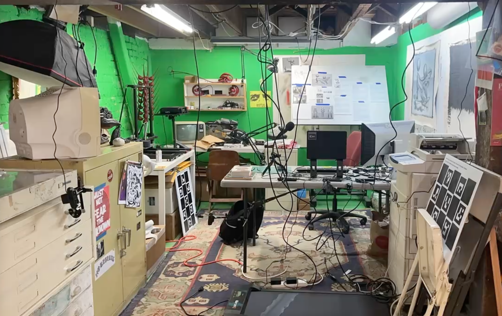
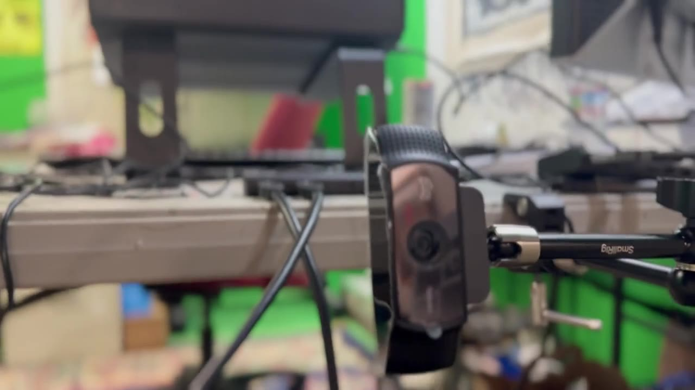
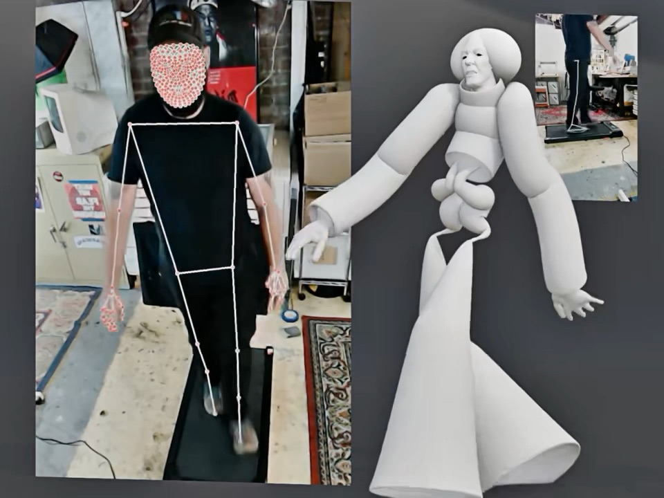
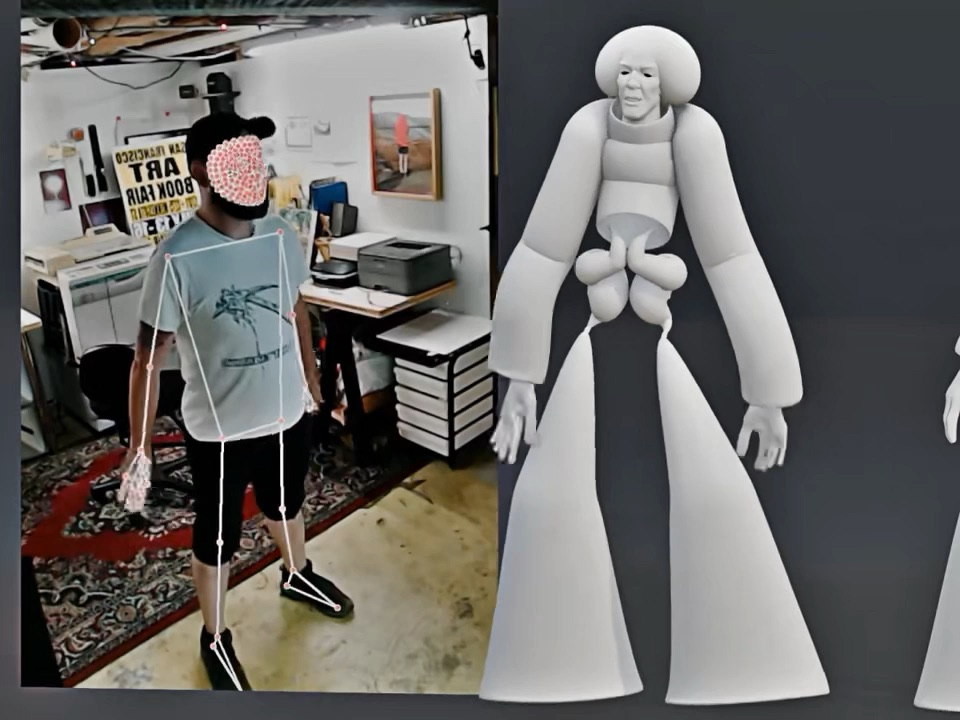
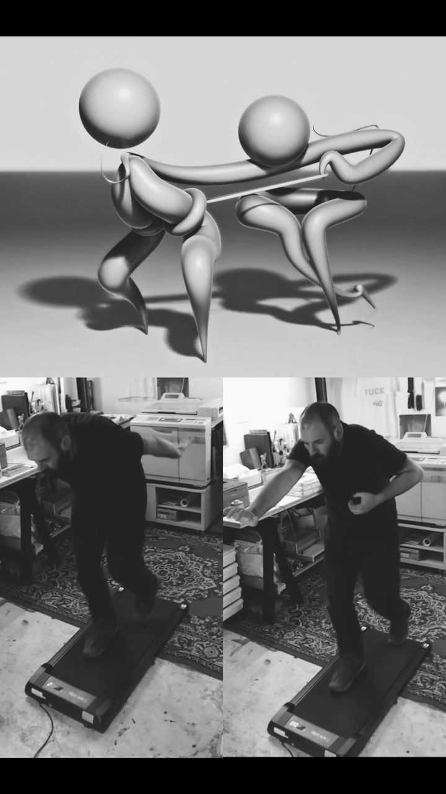
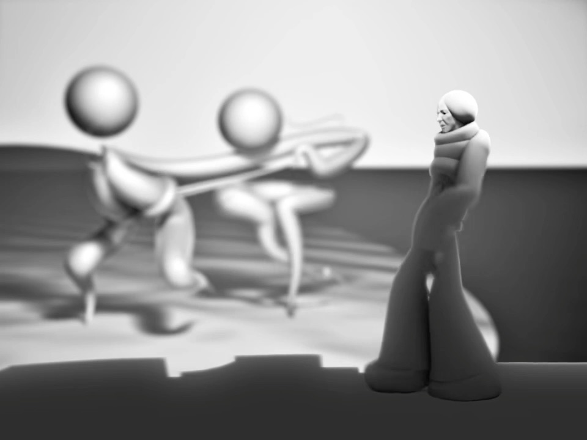
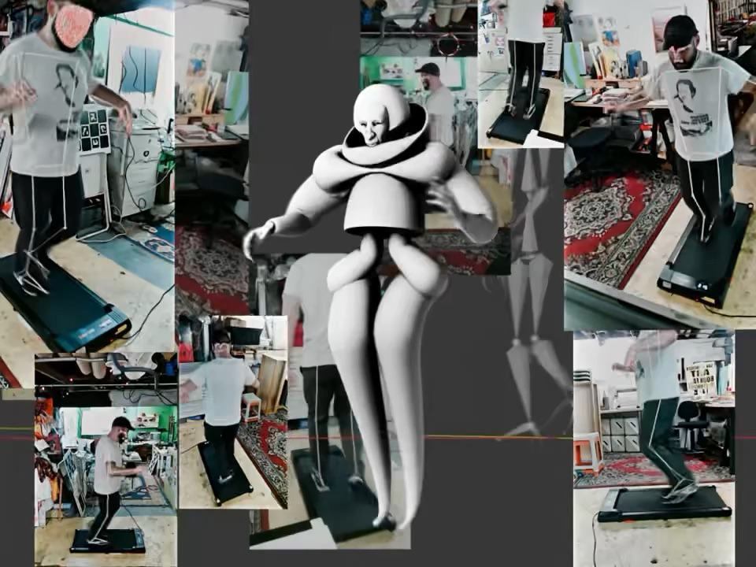
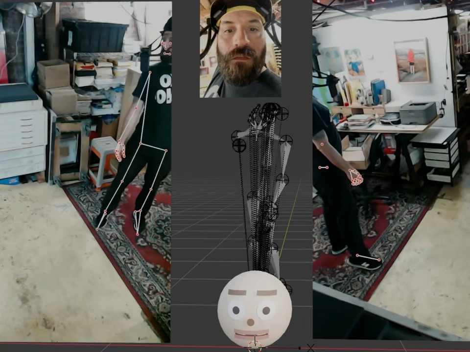
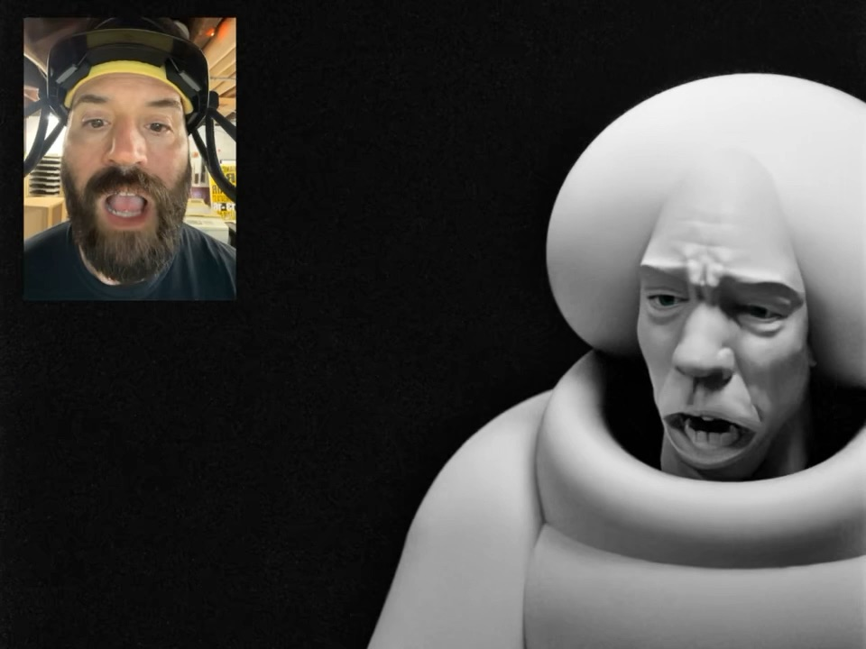

# HIHO Software

Performance capture as a craft, from the classroom to the gallery.

HIHO (Human In, Human Out) is a low-cost performance capture system built from ordinary webcams and free, open-source software, and a method for teaching performance capture to artists. HIHO is a free add-on I built for Blender, the free 3D software my students already use, and it runs the whole FreeMoCap process from inside Blender: calibrate, record, process, and put the performance on your own character. After a one-time setup it runs offline.

This is a documentation and research project. The software is local and bespoke, tailored exactly to what we're doing in class, and based on already established open source tools. It isn't meant to be for everyone.

This repository holds the software side of HIHO, a program for time-based human work: storytelling, performance, animation, games, film, and sound. Everything here is pre-1.0.

## Research

Performance capture records how a person moves and puts that movement onto a digital character. It is usually sold as a hardware and software bundle, as if the equipment did the work, but good captures come from iteration and practice, shaped by the qualities of both the performer and the space they perform in. It is a technique, not a tool, and it needs to be taught by a person.

In Spring 2027, I'll be teaching ART 175-02 at San Jose State University, the first course built around HIHO. The class itself is the method. The research asks two questions: how do students learn to adapt a capture setup to a particular room and a particular movement, and what do they find exciting or confusing along the way?

The first ring tests in an SJSU classroom ran in November 2026, and we are already learning that no single ring setup works everywhere. The cameras have to move with the shape of the room and the shape of the movement being captured.

Validation studies test whether the tool is accurate. This project takes up the next question: how do artists and students learn to capture well?

## Demo video

A full walkthrough of the system, recorded for students: what it is, why it exists, the kit, and the whole workflow from calibration to a cleaned up animation on a rig.

Jump straight to a chapter:

- [0:00 Intro and what is HIHO Mocap](https://youtu.be/3x4TEfNW5bk)
- [2:57 Why build it and what makes it possible](https://youtu.be/3x4TEfNW5bk?t=177)
- [10:53 The kit: a ~$1,400 DIY setup](https://youtu.be/3x4TEfNW5bk?t=653)
- [15:25 The workflow: calibrate, record, bake, clean](https://youtu.be/3x4TEfNW5bk?t=925)
- [31:49 What is next and how to join](https://youtu.be/3x4TEfNW5bk?t=1909)

## Process pics

Click any picture to play its clip.

The animations above come from the studio practice of [David Bayus](https://www.davidbayus.zone), an artist working in San Francisco.

## Why build it

This started out of a need in my own teaching practice: there was no workflow for teaching motion capture that did not push students into expensive equipment or permanent subscriptions.

If you know motion capture, there are really three avenues:

- **Suits.** Around two thousand dollars, and the software is subscription forever, so you never really own your hardware. And getting people to want to put on a suit in a classroom is its own problem.
- **Single camera AI tools.** Easy to use, but subscription again. One camera angle can never give a true, accurate translation of movement in 3D. And the newer tools solve motion generatively, which raises its own questions: where is that data coming from, and what are the ethics behind it?
- **Professional multicam.** Multiple cameras and a triangulation solve. The most accurate way to do this, which is why scientists and expensive film productions use it. Also the most expensive way to do this, with its own proprietary software, far beyond the means of an individual artist. Which is where I live.

Multicam is the right method. It just needed to stop costing more than a car. The breakthrough that makes that possible is FreeMoCap (see Built on below). HIHO Mocap is the artist layer built on top of it, focused on experimental animation and storytelling in Blender.

## The kit, about $1,400 total

Priced from the actual studio build. Nearly all of the cost is cameras, and you do not need to buy everything at once: the system works with a single $120 camera, just noisier. Every camera you add makes the capture cleaner. Most of these pieces cost about as much as a takeout order, so grab one a month, or go in on it with friends.

| Piece | Cost |
|---|---|
| Logitech webcams, up to six, recording 720p at 60 fps | about $120 each |
| Camera rig arms | about $20 each |
| 16 ft USB cables, good ones matter | about $30 each |
| Powered USB hubs, cameras only, two cameras per hub | about $52 each |
| Calibration board, printed big and mounted flat | $10 to 20, often free through school printing |
| Face capture helmet, optional | about $145 |

Plus a normal modern laptop. The studio machine is a stock MacBook Pro, nothing exotic. The software costs nothing.

## The workflow

Four moves, all inside Blender. The [demo](https://youtu.be/3x4TEfNW5bk?t=925) shows every one of them on a real take.

1. **Calibrate.** Every session, no exceptions, even when nothing looks like it moved. The board is a printed ChArUco pattern with 200 mm squares, larger than the usual recommendation, which measurably improved our accuracy and our floor. Walk the space with it for about a minute so at least two cameras always see it, then let the addon check the solve and score it.
2. **Record.** The addon opens a live preview of every camera, a spoken countdown talks you in, and the take lands on disk with per frame timestamps.
3. **Bake.** The take processes through FreeMoCap from inside Blender. Preview the result, then bake it down to plain keyframes on every bone of a simple armature. From there it is just animation: no special rig, nothing proprietary.
4. **Clean.** A Butterworth smooth in the graph editor takes the jitter out. Smooth the hands and arms more, the core less, and never the root. Some shake in fingers and feet at 720p is par for the course, and it cleans up.

## What is here

| Project | What it does | Status |
|---|---|---|
| `HIHO_MOCAP/` | Multi-camera markerless motion capture addon for Blender. Record with a ring of webcams, process through FreeMoCap, get a baked animation on a rig. | Active (v1.5.9) |
| `UV_UNWRAPER/` | PaWrappa, one-click UV unwrapping for student sculpts. | Student-testing ready (v0.3.5) |
| `CADRE_REMESHER/` | Quadre, a quad remesher. | v0.4.7 (2026-10-03): keeps hard edges, picks the best of four quad layouts, and the engine runs outside Blender so it cannot freeze it |
| `green_room/` | Procedural character design toolkit. | Early, recently reactivated |
| `PPPARTY_V2/` | The single-camera era of the mocap work. | Parked (v2.0.4) |
| `PPPARTY_V1_ARCHIVE/` | The phone-era live puppet experiment. | Archived, read only |

## Human In, Human Out

As AI-generated tools spread through digital media, the question is how artists can use this technology in ways that expand what is possible without taking away from the human. That is what the name stands for: Human In, Human Out. From the club newsletter:

> - Claude Opus helped write the code, but a human decided what to build and tested it
> - The capture system uses AI (RTMPose) to find your body, the input is from a real person moving
> - It never invents motion from a prompt
> - A human performs, designs the character, and tells the story
> - The AI is a tool in the middle, never the author

The same rule governs how this software is made. Every feature starts as a plain-language design document. Code is written in collaboration with AI (Claude), one tested change at a time, and a human decides what gets built, what ships, and what gets thrown away.

## Documentation

This repository documents itself in prose, not just commits. Every feature began as a dated design document, every bug hunt has a diagnosis writeup, and every research question has a research doc with its sources. More than a hundred of them live next to the code, and they are the real development history. Start with:

- `HIHO_MOCAP/STATUS.md` for the current state of HIHO MOCAP
- `HIHO_MOCAP/HIHO_MOCAP_WRAPPER_ARCHITECTURE.md` for the architecture and its reasoning
- the dated `*_DESIGN_*` and `*_RESEARCH_*` docs for every decision in between

The working rules: no code before design. One change at a time, one versioned build each, tested on a real capture before the next change begins. If a change makes things worse, it gets reverted, and the reversion is recorded too.

## Timeline

- **Spring 2026.** A phone-based live puppet experiment (PPParty V1) reaches the limit of one camera.
- **Summer 2026.** The multi-camera system (HIHO MOCAP) becomes the main project: a six-webcam ring, printed-board calibration with quality scoring, FreeMoCap processing in an external environment, and a bake-first workflow in Blender.
- **August 2026.** The first full [demo film](https://youtu.be/3x4TEfNW5bk).
- **Fall 2026.** Students. The kit moves to campus, and in November the ring runs its first tests in an SJSU classroom.
- **Spring 2027.** ART 175-02, the first course built around HIHO.

## Built on

The 3D solving engine is [FreeMoCap](https://freemocap.org) (AGPL-3.0), which runs in its own Python environment. HIHO MOCAP drives it and never modifies it. RTMPose does the per-camera body tracking by default, through FreeMoCap 2.0. MediaPipe, through FreeMoCap 1.8.2, stays available as the classic choice. The Blender addon does the rest: recording, calibration scoring, take loading, rig spawning, baking, and export. I am also an educational collaborator with the FreeMoCap team.

What we have learned while driving FreeMoCap in a classroom, written up for their community with every claim sourced and dated: [`HIHO_MOCAP/UPSTREAM_NOTES_FOR_FREEMOCAP_2026-08-05.md`](HIHO_MOCAP/UPSTREAM_NOTES_FOR_FREEMOCAP_2026-08-05.md)

## Who

I am a working artist and a teacher, a Senior Lecturer in Digital Media Art at San Jose State University's CADRE Laboratory, with an MFA from the San Francisco Art Institute. My editions are in the collections of MoMA, the Whitney, LACMA and MOCA. The tools get their field testing in my studio practice before they reach students. More of the work: [www.davidbayus.zone](https://www.davidbayus.zone)

Questions: david.bayus@sjsu.edu

Students: if you find a bug, message me in the class Discord.

## License

AGPL-3.0, the same license as FreeMoCap.
